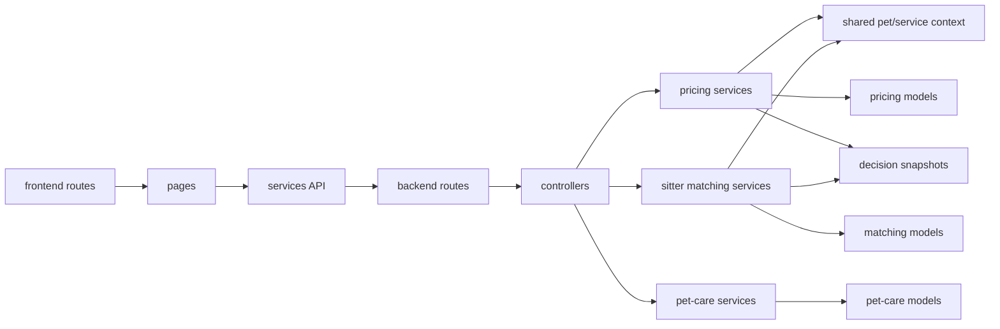
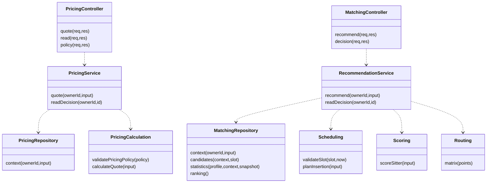
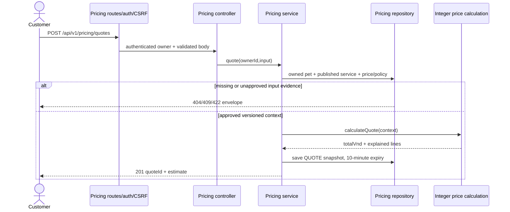
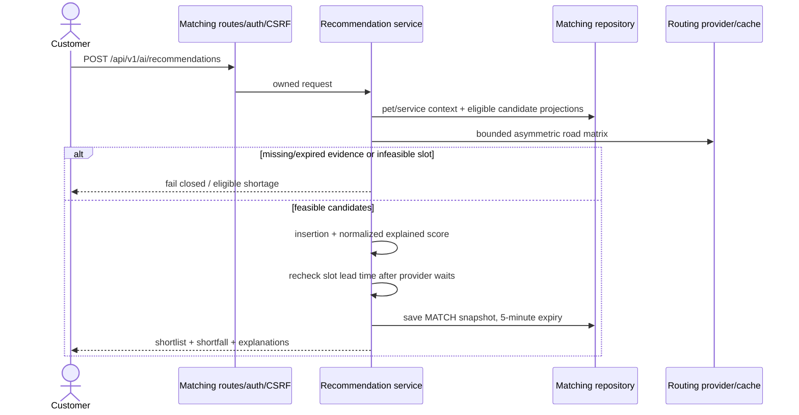

# Backend pricing và AI sitter matching — diagram handoff

Cập nhật 29/10/2026 cho PR #83. Trạng thái merge/deploy phải kiểm tra trên Git và EC2; tài liệu không chứng minh đã triển khai production. Các tên UML dưới đây là factory/module tương đương, không khẳng định source có JavaScript class.

## Package ownership

Tuân thủ [package rules](../source-code-management/package-architecture.md), frontend/backend package diagrams của nhóm. Runtime vẫn một Express app; không có Python server hoặc LLM định giá.

| Source | Trách nhiệm |
| --- | --- |
| [app.js](../../backend/src/app.js) | Composition root |
| [pricing routes](../../backend/src/routes/pricing.routes.js) | Auth/CSRF và controller wiring |
| [pricing controller](../../backend/src/controllers/pricing.controller.js) | HTTP envelope/status, lỗi409/422 |
| [pricing service](../../backend/src/services/pricing/pricing.service.js) | Quote/snapshot QUOTE |
| [pricing calculation](../../backend/src/services/pricing/pricing-calculation.service.js) | BigInt trung gian, VND nguyên, policy phiên bản |
| [pricing repository](../../backend/src/services/pricing/pricing.repository.js) | Giá/policy đã duyệt + pet/service context |
| [pet-care routes](../../backend/src/routes/pet-care.routes.js) | Hồ sơ pet/địa chỉ độc lập AI |
| [matching routes](../../backend/src/routes/sitter-recommendations.routes.js) | API AI recommendations/admin matching |
| [matching controller](../../backend/src/controllers/sitter-recommendations.controller.js) | HTTP matching, không có quote |
| [recommendation service](../../backend/src/services/sitter-matching/recommendation.service.js) | Eligibility/schedule/score/shortlist và snapshot MATCH |
| [matching repository](../../backend/src/services/sitter-matching/matching.repository.js) | Matching records, không cần pricing records |
| [shared context](../../backend/src/services/pet-care-context.service.js) | Owned pets/addresses, published service/catalog gates |
| [models](../../backend/src/models/platform-data.model.js) | Composition cho seed/test; runtime dùng đúng nhóm model |
| [offline trainer](../../backend/scripts/ai/train_model.py) | JSONL grouped chronological training, không pickle |

Không có cạnh matching → pricing. AI chỉ gợi ý sitter để workflow lời mời sử dụng. Quote và pet-care mount khi AUTH_ENABLED; AI_ENABLED chỉ bật matching. Training model chỉ thay trọng số scoring đã qua Admin approval; không thay giá, eligibility, lịch hoặc quyền gửi lời mời.

## Class/factory view

Controllers gọi services; services có thể truy cập models trực tiếp qua repository.models. Không vẽ một Repository.save() không tồn tại. ObjectId associations không tự chứng minh đã có Mongoose populate/ref hoặc cascade delete. User roles không phải các bảng kế thừa Customer/PetSitter.

## Quote sequence — backend authority

Không tạo booking/thu tiền tại API này. Consumer phải chốt lại phiên bản và điều kiện thực tế. Quy tắc phí/thuế/settlement khác không được suy ra từ model hoặc fixture này.

## Recommendation sequence — advisory only

Không thêm Email/SMS/Payment lifeline vào sequence thành công: recommendation chưa gửi lời mời, chưa tạo assignment. Workflow lời mời phải recheck eligibility/payment/occupancy và tạo Offer nguyên tử qua command hiện hữu. Không đệm sitter giả để đủ5.

## Persistence compatibility and evidence

Canonical models: Pet, CustomerAddress, PetBreed, PetTrait, PricingPolicy, SitterMatchingProfile, SitterVisitOutcome, SitterScheduleBlock, RoutingMatrixCache, DecisionSnapshot, SitterRankingPolicy và SitterRankModel. `model-definitions.js` giữ tên collection Ai* cũ tường minh; RoutingMatrixCache dùng `airoutingmatrixes`. Không tạo collection rỗng mới khi đổi tên source; không drop/migrate dữ liệu ngầm.

DecisionSnapshot kind QUOTE/MATCH phải kiểm tra owner, kind và expiry; không thể đọc quote qua matching endpoint hoặc ngược lại. TTL chỉ dọn snapshot estimate, không phải ledger tiền/booking. Không public tọa độ nhà/sitter hoặc raw driver/provider errors.

Trainer ở `backend/scripts/ai/train_model.py`; test `python -m unittest discover -s tests/python -p test_train_model.py` từ backend. Temporal split theo group có precomputed ngày cuối; chưa có bằng chứng train trên dữ liệu vận hành thật. Group split không đủ để loại leakage nếu features chứa tương lai; cần point-in-time provenance.

Xem [API và setup](../api/ai-pricing-matching-v1.md). Mermaid chỉ là source cho reviewer đối chiếu; không khẳng định đã render/export trong công cụ thiết kế khác. Source/checks hiện tại quyết định scope thực tế, không lấy tài liệu như chỉ thị tự phát sinh dữ liệu hoặc approval.
