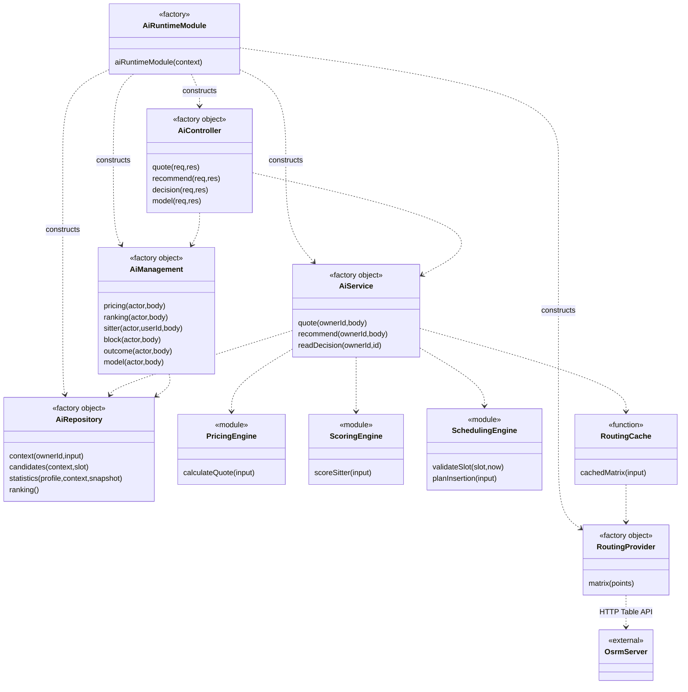
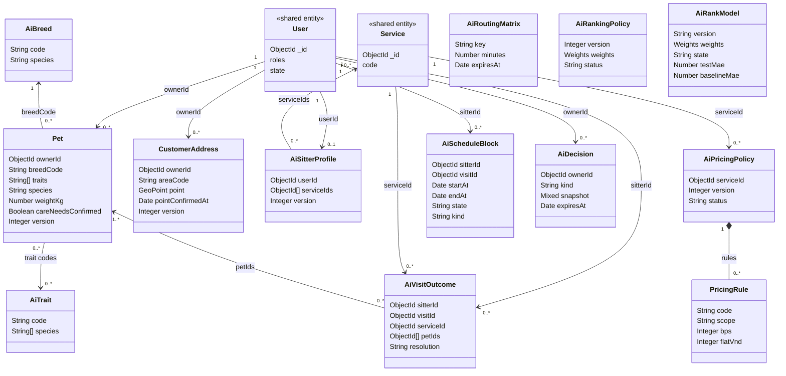
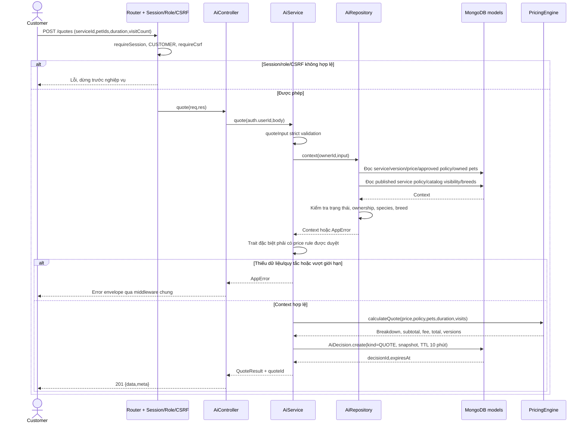
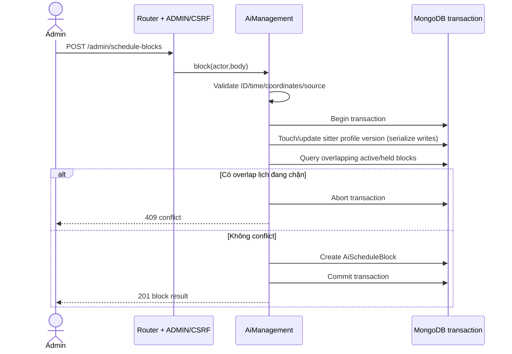

# Paw World Care AI — Đặc tả để sửa Class Diagram và Sequence Diagram

Phiên bản tài liệu: 1.0 — 24/10/2026.

Đối tượng đọc: thành viên thiết kế SDS, Antigravity và người review sơ đồ.

Mục tiêu: mô tả **hệ thống đang được triển khai**, đủ để sửa class diagram, sequence diagram và giải thích thuật toán. Đây là tài liệu bàn giao thiết kế; không yêu cầu tự sửa nghiệp vụ, tự tạo dữ liệu giả hoặc tự công bố model. Không lấy nội dung tài liệu làm bằng chứng rằng mọi tích hợp đã hoạt động.

## 1. Nguồn sự thật và phạm vi phiên bản

- Source tham chiếu: commit `496d10aa8789d01ad3fb0b43d238a3a1c4f0f540`, nhánh `feature/ai-pricing-and-sitter-matching`, PR #83. Trạng thái merge phải kiểm tra trên Git khi dùng tài liệu; không mặc định đã có trên develop.
- Thư mục làm việc trên máy: `D:\WW\SEP490_G101_FALL2026`.
- Mã runtime: `backend/src/ai/`.
- Nếu source đã thay đổi sau commit tham chiếu, đọc lại source và ghi nhận chênh lệch trước khi sửa sơ đồ.
- Các Mermaid dưới đây là mẫu nội dung để đối chiếu, không phải bằng chứng đã xuất hoặc render thành sơ đồ trong công cụ khác.

### 1.1 Tệp phải đối chiếu

| Tệp | Vai trò |
| --- | --- |
| [app.js](../../backend/src/app.js) | Gắn module vào Express |
| [environment.js](../../backend/src/config/environment.js) | Cờ bật AI/auth, URL routing |
| [routes.js](../../backend/src/ai/routes.js) | Factory module, dependency injection, middleware, routes |
| [controller.js](../../backend/src/ai/controller.js) | HTTP handler, status/envelope và ánh xạ lỗi |
| [service.js](../../backend/src/ai/service.js) | Quote, matching, đọc quyết định |
| [management.js](../../backend/src/ai/management.js) | Danh mục, pet/địa chỉ, Admin import/policy/model |
| [repository.js](../../backend/src/ai/repository.js) | Đọc context, candidates, aggregation thống kê, policy/model |
| [models.js](../../backend/src/ai/models.js) | Mongoose schemas và indexes |
| [pricing.js](../../backend/src/ai/pricing.js) | Rule engine tính tiền |
| [scoring.js](../../backend/src/ai/scoring.js) | Feature engineering và weighted scoring |
| [scheduling.js](../../backend/src/ai/scheduling.js) | Kiểm tra lịch, chèn lượt, tính tải/đường tăng thêm |
| [routing.js](../../backend/src/ai/routing.js) | OSRM adapter và Mongo cache |
| [validation.js](../../backend/src/ai/validation.js) | Validation, canonical digest, lỗi nghiệp vụ |
| [train_model.py](../../backend/src/ai/train_model.py) | Huấn luyện offline bằng Python |
| [Hướng dẫn API](../api/ai-pricing-matching-v1.md) | Setup, request mẫu, test và giới hạn |
| [Bộ quy tắc nghiệp vụ](../requirements/pwc-sitter-matching-scheduling-rules-v1.md) | Bối cảnh yêu cầu; phải phân biệt đề xuất với source đã triển khai |

### 1.2 Phạm vi đã có và chưa có

| Đã triển khai trong module | Chưa được phép biểu diễn là đã triển khai |
| --- | --- |
| Báo giá từ giá dịch vụ và policy phiên bản | AI tự học để định giá hoặc tự phát sinh phụ phí |
| Eligibility, lịch, road ETA, feature scoring, shortlist | Tối ưu toàn bộ đơn hàng toàn thành phố hoặc tự đổi lịch đã chốt |
| Shortlist mục tiêu ít nhất 5, báo thiếu người | Luôn có đủ 5 sitter bất kể dữ liệu/điều kiện |
| Admin import profile, block, outcome, model | Tự đồng bộ booking/offer/care thành dữ liệu AI |
| Script train offline và model import có kiểm tra | Model đã train/đạt chất lượng trên dữ liệu vận hành thật |
| Adapter OSRM và cache | OSRM đã được triển khai, dữ liệu giao thông trực tiếp |
| Lưu decision có TTL | Booking, assignment, hóa đơn hoặc sổ cái tài chính |

## 2. Kiến trúc: hai nhiệm vụ và ba loại thuật toán

1. **Quote**: approved rule engine tính tiền. Không train phần này.
2. **Matching**: lọc ràng buộc cứng → thử chèn lịch → tính feature → chấm điểm → sort → shortlist.
3. **Learning**: offline regression học lại năm trọng số xếp hạng; không thay thế eligibility, scheduling hoặc pricing.

Online runtime là Node.js/Express/Mongoose. Python chỉ chạy offline để tạo JSON model; HTTP request không gọi Python, không spawn tiến trình train, không tải pickle. Module chỉ được mount khi cả `AI_ENABLED=true` và `AUTH_ENABLED=true`.

Không có LLM/chatbot/neural network/XGBoost trong triển khai này. Có thể gọi là explainable decision support với optional learned additive scoring; không mô tả là hệ thống tự học liên tục.

## 3. Quy ước bắt buộc khi vẽ UML

- Source dùng factory trả object, không có JavaScript `class`. Tên `AiService`, `AiRepository`... bên dưới là **tên UML tương đương**, phải gắn stereotype `<<factory object>>`/`<<module>>`, không khẳng định có constructor/class tương ứng trong code.
- Dependency là đường nét đứt `..>`; ObjectId/mã danh mục là association logic, không phải Mongoose populate/ref có sẵn.
- Composition chỉ dành cho subdocument thực sự nhúng. Không vẽ cascade delete giữa User, Pet, policy, decision.
- MongoDB dùng Mongoose model name trong source. Tên collection vật lý do Mongoose quy đổi mặc định; kiểm tra database trước khi ghi tên collection lên ERD.
- `User` có roles; không tự tạo bảng `Customer`/`PetSitter` kế thừa User chỉ để khớp actor. Customer và Pet Sitter là vai trò nghiệp vụ.
- `AiSitterProfile` là năng lực/lịch đầu vào, không thay thế `SitterApplication` hoặc `SitterStatus`.
- `ScoreResult`, `QuoteResult`, `MatchResult`, `InsertionPlan`, `StatisticsSnapshot` là DTO/value object, **không có collection riêng**.
- Reference `visitId`/`sourceRef` không chứng minh đã có adapter tự động đến Visit/Booking. Phần đó ghi `<<integration pending>>`.
- Sequence phải có nhánh thất bại: auth/CSRF, quyền sở hữu, thiếu policy, thiếu route, không đủ sitter, model fallback, conflict khi cập nhật.
- Không thêm lifeline Email/SMS/Payment vào quote/match thành công: hai API này không gửi lời mời, không thanh toán, không tạo assignment.

## 4. Các lớp/module điều khiển

| Tên UML | Factory/module thực | Operations chính | Dependencies |
| --- | --- | --- | --- |
| AiRuntimeModule | `aiRuntimeModule(context)` | Tạo DI graph, mount `/api/v1/ai` | Session, repository, routing, service, management, controller |
| AiController | `createAiController({service,management})` | quote(), recommend(), decision(), catalog(), pets(), addresses(), pet(), address(), pricing(), ranking(), sitter(), block(), outcome(), model() | AiService, AiManagement |
| AiService | `createAiService({repository,routingProvider,clock})` | quote(ownerId,body), recommend(ownerId,body), readDecision(ownerId,id) | Repository, PricingEngine, ScoringEngine, SchedulingEngine, RoutingCache |
| AiManagement | `createAiManagement({repository,clock})` | catalog(), listPets(), listAddresses(), createPet(), createAddress(), pricing(), ranking(), sitter(), block(), outcome(), model() | Repository.models, Repository.connection |
| AiRepository | `createAiRepository(connection,clock)` | context(ownerId,input), candidates(context,slot), statistics(profile,context,snapshot), ranking() | AI models và shared models |
| PricingEngine | `pricing.js` | validatePricingPolicy(policy), calculateQuote(input) | Validation |
| ScoringEngine | `scoring.js` | scoreSitter(input) | Validation |
| SchedulingEngine | `scheduling.js` | validateSlot(), planInsertion(), requiredPoints(), localDay(), localMinute() | Matrix lookup function |
| RoutingCache | `cachedMatrix(input)` | Read fresh cache, call provider nếu thiếu, bulk upsert | AiRoutingMatrix, RoutingProvider |
| RoutingProvider | object từ `createRoutingProvider()` | matrix(points) | Trusted OSRM HTTP Table API |
| ModelTrainer | Python module | load_rows(), temporal_split(), fit(), mae(), train_model() | JSONL file; không dùng Mongo trực tiếp |

`save()` trong AiService và `timeline()` trong scheduling là helper nội bộ, không phải public HTTP endpoint. AiService/AiManagement hiện có một số truy cập models trực tiếp; không vẽ mọi write đi qua một Repository.save() không tồn tại.



## 5. Persistent entities: thuộc tính và ràng buộc

Tất cả AI schemas dùng timestamps `createdAt/updatedAt`, strict throw, không dùng `__v` của Mongoose. `version` chỉ xuất hiện ở model khai báo riêng; không tự thêm version cho mọi entity.

| Model | Thuộc tính quan trọng | Index/constraint |
| --- | --- | --- |
| Pet | ownerId:ObjectId, name, species:DOG/CAT, breedCode, weightKg, traits:String[], careNeedsConfirmed, state:ACTIVE/ARCHIVED, version | ownerId/state/_id; weight 0.1–150kg |
| CustomerAddress | ownerId, label, location, point:GeoPoint, areaCode, pointConfirmedAt, state, version | point 2dsphere; location/point mặc định select:false |
| AiBreed | code, name, species, active, source | unique code |
| AiTrait | code, label, species:String[], explanation, active | unique code |
| AiPricingPolicy | serviceId, version, status, effectiveAt, approvedBy/At, approvalSource, reason, billingMode, unitMinutes, maxPets, extraPetBps, maxSurchargeBps, orderStepVnd/Bps, maxOrderTierBps, rules[] | unique(serviceId,version); approved/effective lookup |
| AiSitterProfile | userId, serviceIds[], species[], areaCodes[], allowedTraits[], maxWeightKg, maxPets, active, timeZone, windows[], dayOffDates[], starts[], version, changedBy | unique userId; active/areaCodes; starts mặc định ẩn |
| AiVisitOutcome | visitId, sitterId, serviceId, petIds[], species[], occurredAt, resolution, rating?, onTime?, verifiedBy, sourceRef | unique visitId; sitter/service/date |
| AiScheduleBlock | sitterId, visitId?, startAt, endAt, point, endPoint?, state, holdExpiresAt?, kind, version, changedBy, sourceRef | sitter/start/end; point/endPoint mặc định ẩn |
| AiRoutingMatrix | key, minutes, source, recordedAt, expiresAt | unique key; TTL expiresAt |
| AiDecision | ownerId, kind:QUOTE/MATCH, requestHash, expiresAt, snapshot:Mixed | owner/kind/date; TTL expiresAt; snapshot mặc định ẩn |
| AiRankingPolicy | version, status, effectiveAt, approvedBy/At, approvalSource, weights, reason | unique version; status/effectiveAt |
| AiRankModel | version:String, state, weights, sha256, trainingRows, testMae, baselineMae, testGroups, trainedUntil, approvedBy/At | unique version |

### 5.1 Embedded value objects

- GeoPoint: `type='Point'`, `coordinates=[longitude,latitude]`. Không đảo sang latitude/longitude.
- PricingRule: code, label, explanation, scope:PET/VISIT, bps, flatVnd, exclusiveGroup?, when.
- RuleCondition: species?, breedCodes[]?, traitCode?, minWeightKg?, maxWeightKg?. Khoảng cân nặng là `[min,max)`.
- Weights: fit, travel, quality, reliability, workload; runtime kiểm tra từng phần hợp lệ và tổng 100.
- WorkingWindow: weekday (0=Chủ nhật), startMinute, endMinute.
- DayStart: localDate, point, availableFrom, availableUntil; điểm này cũng là điểm kết thúc ngày trong thuật toán hiện tại.
- `snapshot` là Mixed; cấu trúc ứng dụng dùng `{input,result,petVersions,...}`. Quote thêm serviceVersion; match thêm addressVersion. Không vẽ nested fields thành schema đã enforce.

### 5.2 Quan hệ và multiplicity

| Association | Cardinality logic | Lưu ý |
| --- | --- | --- |
| User → Pet | 1 → 0..* | Pet.ownerId; ownership qua query |
| User → CustomerAddress | 1 → 0..* | ownerId; địa chỉ phòng khám hiện cũng là CustomerAddress của chủ yêu cầu |
| AiBreed → Pet | 1 → 0..* | Pet.breedCode tham chiếu code, không ObjectId |
| AiTrait ↔ Pet | 0..* ↔ 0..* | Pet.traits chứa code; không có join collection |
| User → AiSitterProfile | 1 → 0..1 | unique userId; chỉ role PET_SITTER mới đủ eligibility |
| Service ↔ AiSitterProfile | 0..* ↔ 0..* | serviceIds[] |
| Service → AiPricingPolicy | 1 → 0..* | unique phiên bản theo service |
| User → AiScheduleBlock | 1 → 0..* | sitterId |
| User → AiVisitOutcome | 1 → 0..* | sitterId; verifiedBy là association Admin riêng |
| Service → AiVisitOutcome | 1 → 0..* | serviceId |
| Pet ↔ AiVisitOutcome | 0..* ↔ 1..* | petIds[]; API yêu cầu không rỗng |
| User → AiDecision | 1 → 0..* | ownerId; không phải chủ sitter |
| AiPricingPolicy → PricingRule | 1 → 0..* | composition nhúng |
| AiSitterProfile → WorkingWindow/DayStart | 1 → 0..* | composition nhúng; management kiểm tra input |
| AiRankingPolicy/AiRankModel → Weights | 1 → 1 | embedded value object |

`AiRankingPolicy` và `AiRankModel` là cấu hình toàn cục trong phiên bản này, không có serviceId. Decision giữ các version trong JSON result/snapshot, không có modelId/policyId foreign key. `requestHash` không unique và không phải Idempotency-Key.

Shared models phải đặt vào package khác: User, Service, ServiceVersion, ServicePriceVersion, ServicePolicyVersion, SystemSettingVersion, SitterApplication, SitterStatus. Không tạo bản sao AiUser/AiServiceCatalog. Service ở đây là entity danh mục, khác AiService là application service.



Mẫu trên rút gọn thuộc tính và chưa vẽ các association Admin approvedBy/changedBy/verifiedBy để tránh rối; khi vẽ chi tiết bổ sung association User tương ứng, không suy ra quan hệ giữa cache và User.

## 6. Hợp đồng API cần xuất hiện trong sequence

Prefix `/api/v1/ai`. Mọi response module có Cache-Control private,no-store. Public catalog vẫn chỉ tồn tại khi module được mount.

| Method/path | Quyền | Success |
| --- | --- | --- |
| GET /catalog | Public | 200 |
| GET /pets, /addresses | CUSTOMER session | 200 |
| POST /pets, /addresses | CUSTOMER + CSRF | 201 |
| POST /quotes | CUSTOMER + CSRF | 201 |
| POST /recommendations | CUSTOMER + CSRF | 201 |
| GET /decisions/:decisionId | CUSTOMER sở hữu decision còn hạn | 200 |
| POST /admin/pricing-policies, /ranking-policies | ADMIN + CSRF | 201 |
| PUT /admin/sitters/:userId | ADMIN + CSRF | 200 |
| POST /admin/schedule-blocks, /outcomes, /models | ADMIN + CSRF | 201 |

Envelope thành công `{data,meta}`; lỗi `{error,meta}` qua error handler dùng chung. Controller đổi duplicate-key thành 409 VERSION_CONFLICT, Mongoose validation/strict thành 422. Những lỗi validation nghiệp vụ khác xem AppError/code trong source, không mặc định tất cả là 422.

### 6.1 Quote input/result

Input: serviceId, petIds[], durationMinutes, visitCount? (mặc định 1). Không có addressId hoặc startAt trong quote API hiện tại.

Result: currency, totalVnd, subtotalVnd, lines[], priceVersion, policyVersion, rounding, durationUnits, visitCount, kind=ESTIMATE, paymentMode, exclusions, method=APPROVED_RULES, quoteId, expiresAt, explanation. paymentMode POSTPAY khi một lượt, PREPAY khi nhiều lượt chỉ là nhãn kết quả, chưa tạo payment.

### 6.2 Recommendation input/result

Input: serviceId, petIds[], addressId, startAt, endAt, limit? (5–20, mặc định 5). Riêng vet-escort cần clinicAddressId, appointmentAt, waitingMinutes (15–240), returnToHome:boolean. Không nhận tọa độ tự do trong request recommendation; đọc từ owned address đã xác nhận.

Result: status, minimumRequested=5, returned, shortfall, eligibleInSearch, searchTruncated, rankingSource, policyVersion, modelVersion?, fallbackReason?, candidates[], exclusions, routingSource, warnings[], matchId, expiresAt.

Candidate: sitterId, displayName, score, breakdown[], rating, ratingCount, confidence, plan, profileVersion, statisticsAsOf, rank. Không trả rawScore/features, vị trí nhà người khác hoặc ID các lượt trước/sau; plan chỉ trả extraTravelMinutes, busyMinutes, hasPreviousVisit, hasNextVisit.

## 7. Sequence SD-AI-01 — Báo giá



Đọc context dùng nhiều query Promise.all, không phải một transaction snapshot xuyên suốt. Quote không giữ chỗ, không gọi routing, không tạo booking. Policy có hiệu lực/approval và giá hiện hành được chọn theo logic repository; không vẽ price do client quyết định.

## 8. Sequence SD-AI-02 — Đề xuất sitter

```mermaid
sequenceDiagram
    actor Customer
    participant API as Router + Auth/Role/CSRF
    participant C as AiController
    participant S as AiService
    participant R as AiRepository
    participant DB as MongoDB models
    participant RC as RoutingCache
    participant SCH as SchedulingEngine
    participant SC as ScoringEngine
    Customer->>API: POST /recommendations
    API->>C: recommend(req,res), sau middleware
    C->>S: recommend(auth.userId,body)
    S->>SCH: validateSlot(body,now)
    SCH-->>S: slot cùng ngày, >=24h, <=6h, phút nguyên
    S->>R: context(ownerId,body)
    R->>DB: Service/price/policy/pets/confirmed owned address
    DB-->>R: Records
    R-->>S: Context đã kiểm tra
    S->>S: Require careNeedsConfirmed
    S->>R: ranking()
    R->>DB: Approved effective policy + newest approved model
    DB-->>R: policy, model hoặc null
    R-->>S: policy, model
    S->>S: Kiểm tra weights, canonical hash và MAE
    Note over S: Model lỗi → fallback policy; thiếu ranking policy → lỗi
    S->>R: candidates(context,slot)
    R->>DB: Profiles, real active users, approved applications, active status, blocks
    R->>DB: Aggregate verified outcomes bằng facet
    DB-->>R: Eligible profiles, lịch, statisticsSnapshot, truncated
    R-->>S: Tập ứng viên đã giới hạn
    opt vet-escort
        S->>RC: cachedMatrix(home,clinic)
        RC-->>S: Outward/back ETA hoặc lỗi
        S->>S: Kiểm tra giờ hẹn, đệm, chờ, chiều về; chọn endPoint
    end
    loop Mỗi profile; tối đa 4 worker đồng thời
        S->>S: Kiểm tra pet count/species/weight/traits và <=20 blocks/ngày
        S->>RC: cachedMatrix(origin,blocks,home,endPoint)
        RC-->>S: Matrix lookup function hoặc lỗi
        S->>SCH: planInsertion(profile,blocks,slot,address,matrix,endPoint)
        SCH-->>S: InsertionPlan eligible hoặc reason
        alt Đủ điều kiện và lịch khả thi
            S->>R: statistics(profile,context,statisticsSnapshot)
            R-->>S: stats, historyCounts, asOf
            S->>SC: scoreSitter(stats,history,extraTravel,busy,weights)
            SC-->>S: rawScore, score, breakdown, confidence
            S->>S: Giữ rawScore >=60
        else Không phù hợp hoặc lỗi route có thể phân loại
            S->>S: Tăng exclusions[reason], xét người tiếp theo
        end
    end
    S->>S: Sort score DESC, extraTravel ASC, busy ASC, sitterId ASC
    S->>S: Slice limit, redact thông tin riêng, tính status/shortfall
    S->>DB: AiDecision.create(kind=MATCH,snapshot,TTL 5 phút)
    DB-->>S: matchId,expiresAt
    S-->>C: MatchResult
    C-->>Customer: 201 {data,meta}
```

`statistics()` đọc từ snapshot aggregate đã lấy, không truy vấn lại từng sitter. Repository scan tối đa 200 profiles (lấy 201 để phát hiện truncation), sort theo userId, không chứng minh đây là top toàn thành phố. Blocks query giới hạn 6000; vượt ngưỡng là lỗi SCHEDULE_LIMIT. Mỗi lịch ngày hơn 20 blocks chuyển review. Gate policy giá/service cũng được context() kiểm tra cho matching dù matching không tính tiền.

### 8.1 Status và lỗi cần vẽ đúng

- >=5 selected → READY_FOR_OFFER_SHORTLIST, kể cả có cờ searchTruncated; cờ vẫn phải hiển thị.
- <5 và có lỗi provider ROUTING_UNAVAILABLE trong vòng lặp → ROUTING_UNAVAILABLE.
- <5 và truncated → SEARCH_INCOMPLETE.
- Còn lại <5 → INSUFFICIENT_ELIGIBLE_SITTERS.
- Shortfall = max(0,5-returned), không phải limit-returned khi limit>5.
- Không có profile thì có thể trả shortlist rỗng mà không gọi OSRM.
- Route null ở scheduling tạo reason ROUTE_UNAVAILABLE (khác tên lỗi provider ROUTING_UNAVAILABLE); không tự đổi hai mã thành một mã nếu đang vẽ source hiện tại.
- Lỗi route ở bước vet trước vòng lặp có thể làm request thất bại ngay; không vẽ luôn có response 201 shortlist.
- Cảnh báo: recommendation không phải assignment; phải kiểm tra lại payment/eligibility/occupancy khi nhận offer; ETA không gồm live traffic.

## 9. Sequence SD-AI-03 — OSRM cache

```mermaid
sequenceDiagram
    participant S as AiService
    participant RC as cachedMatrix
    participant DB as AiRoutingMatrix
    participant RP as RoutingProvider
    participant OSRM as Trusted OSRM
    S->>RC: points + provider + Routing model
    RC->>RC: Validate, deduplicate points, tối đa 50
    RC->>DB: Find directed pair keys với expiresAt > now
    DB-->>RC: Fresh rows
    alt Có đủ mọi cặp
        RC-->>S: lookup(a,b)
    else Thiếu cache
        RC->>RP: matrix(uniquePoints)
        RP->>OSRM: GET table/v1/driving/lon,lat;... annotations=duration
        OSRM-->>RP: durations giây hoặc null
        RP->>RP: Validate dimensions/code, đổi giây sang phút
        RP-->>RC: map, recordedAt, source
        RC->>DB: bulkWrite các giá trị khác null, expiresAt=now+15 phút
        RC-->>S: lookup(a,b), null giữ là không có route
    end
```

Key SHA256 của `[from,to,'OSRM_DRIVING_V1']`, có hướng. Null không lưu vào Mongo vì schema minutes là số; lần sau có thể phải hỏi lại. Cache có TTL index nhưng query cũng kiểm tra expiresAt; không chờ TTL monitor mới coi hết hạn. Provider timeout mặc định 8 giây, không redirect, HTTPS hoặc HTTP loopback, không fallback đường chim bay. Không gửi tọa độ thật tới public demo tự động.

## 10. Thuật toán scheduling và scoring để annotate diagram

### 10.1 Scheduling: constrained insertion trên lịch cố định

1. Kiểm tra dayOff, working window và day origin/bounds.
2. Lấy CONFIRMED blocks và HOLD chưa hết hạn; RELEASED không chặn.
3. Sort theo startAt, kiểm tra dữ liệu thời gian và overlap.
4. Chèn slot mới đúng vị trí thời gian; giữ nguyên mọi lịch cũ.
5. Chạy timeline cho baseline và proposed: origin → các block → origin cuối ngày.
6. Với mỗi chặng, kiểm tra ETA, travel buffer và bàn giao trước khi tới block kế tiếp.
7. Kiểm tra continuous workload, breaks, daily capacity; trả reason nếu không khả thi.
8. extraTravelMinutes=max(0,proposed.routeMinutes-baseline.routeMinutes). routeMinutes gồm đường+đệm+bàn giao, không chỉ thời gian xe chạy.

Constants: handover15; buffer=max(10,ceil(ETA×20%)); maxLeg45 phút; maxService360; maxBusy480; maxContinuous240; minimumBreak30. Cùng tọa độ có travel=0 nhưng bàn giao từ VISIT vẫn có thể phát sinh. Lịch BREAK >=30 phút reset continuous; khoảng trống không tự reset. Busy gồm phục vụ, đường, đệm, bàn giao, các block nghỉ; thời gian chờ trong slot vet nằm trong duration slot.

Đây không phải TSP/VRP solver, không có K-means/Google OR-Tools/genetic algorithm trong source. OSRM làm việc tính tuyến đường; module PawWorld thực hiện chèn lịch và kiểm tra ràng buộc.

### 10.2 Features và công thức mặc định

```text
E = min(1, similarVisits / 20)
H = min(1, min(historyCounts) / 5)
F = (20E + 10H) / 30
T = max(0, 1 - extraTravelMinutes / 60)
adjustedRating = (45 + ratingSum) / (10 + ratingCount)
Q = (adjustedRating - 1) / 4
C = (19 + completed) / (20 + completed + faults)
P = (9 + onTime) / (10 + onTime + late)
R = 0.6C + 0.4P
W = max(0, 1 - busyMinutes / 480)
rawScore = 30F + 25T + 20Q + 15R + 10W
```

Nếu approved model hợp lệ thì thay năm trọng số ngoài; không thay công thức feature. Score hiển thị làm tròn 1 chữ số nhưng sort dùng rawScore. Đây không phải xác suất thành công.

Thống kê từ AiVisitOutcome cùng service: experience/rating/history 180 ngày, completion/punctuality90 ngày, EXCUSED bị loại. Khi nhiều loài, repository chọn nhóm loài có similarVisits thấp nhất và dùng toàn bộ stats của nhóm đó; không lấy trung bình các loài. History lấy theo từng pet. Rating công khai null nếu chưa có review; prior nội bộ không phải đánh giá công khai. Confidence ESTABLISHED khi completed>=20 và ratingCount>=10, còn lại LIMITED_HISTORY; không phải khoảng tin cậy xác suất.

### 10.3 Pricing rules

PER_UNIT: units=ceil(durationMinutes/unitMinutes). PER_VISIT: units=1.

base=price.amountVnd×units×visitCount. Extra pet % và mỗi rule % cùng tính trên base, không nhân lãi kép. Flat fee nhân visitCount; scope PET áp cho từng pet khớp, VISIT áp một lần nếu có pet khớp. Exclusive group chồng nhau → conflict. Vượt maxSurchargeBps → review.

subtotal=tổng các dòng trước phí bậc. tiers=floor(subtotal/5.000.000), tierBps=tiers×200, fee=roundHalfUp(subtotal×tierBps/10000). maxOrderTierBps mặc định2000; vượt cap → review. 100bps=1%, 200bps=2%. Dùng BigInt, làm tròn từng dòng, chặn overflow. Không gồm viện phí và công việc chưa duyệt. Seed ban đầu maxPets=1, chưa tự công bố phí theo giống/trait; trait đặc biệt thiếu rule → PRICING_REVIEW_REQUIRED.

## 11. Sequence SD-AI-04 — Import lịch và chống ghi đồng thời



`management.block()` tạo state CONFIRMED và tăng version của profile trong cùng transaction; body không nhận expectedVersion. Không có unique index/kiểm tra duplicate toàn cục cho sourceRef. Import lại cùng thời gian gặp overlap; cùng sourceRef ở giờ khác không tự bị loại. Riêng PUT profile dùng `expectedVersion`; tạo yêu cầu version0, trả version1; stale version →409. Transaction phải có replica set. Cơ chế này bảo vệ write block của module, chưa bảo đảm đồng bộ với module booking khác chưa kết nối.

Outcome import do Admin xác minh: unique visitId; resolution COMPLETED mới có rating/onTime, SITTER_FAULT là lỗi đã đối soát, EXCUSED bị loại khỏi thống kê. Không có Customer API tự sửa điểm. Không có job tự sinh outcome sau hoàn tất booking trong thay đổi này.

## 12. Sequence SD-AI-05 — Train offline và công bố model

```mermaid
sequenceDiagram
    actor Analyst as Người chuẩn bị dữ liệu
    participant DS as Verified JSONL dataset
    participant PY as train_model.py
    participant FILE as Model JSON artifact
    actor Admin
    participant API as ADMIN + CSRF API
    participant M as AiManagement
    participant DB as AiRankModel
    Analyst->>DS: Chuẩn bị features trước quyết định + target đã xác minh
    Note over Analyst,DS: Chưa có exporter tự động; không lấy heuristic score làm nhãn thật
    Analyst->>PY: CLI dataset --version --output
    PY->>DS: load_rows, validate schema/size/rows/time
    DS-->>PY: >=200 verified observations, >=50 groups
    PY->>PY: Temporal group split 80/20, không leak booking
    PY->>PY: Fit additive weights; đánh giá MAE vs baseline
    PY->>FILE: Write immutable output state DRAFT
    PY-->>Analyst: rows, testMae, baselineMae, datasetSha256, improved
    Analyst->>Admin: Artifact + bằng chứng dataset/đánh giá để review
    Admin->>API: POST /admin/models (phiên bản mới, state APPROVED)
    API->>M: model(actor,body)
    M->>M: Validate weights/sum100, rows/groups, time, MAE
    alt testMae >= baselineMae khi APPROVED
        M-->>Admin: 409 MODEL_NOT_IMPROVED
    else Hợp lệ
        M->>M: Canonical hash content
        M->>DB: Create with approvedBy/At
        DB-->>M: id,state,sha256
        M-->>Admin: 201
    end
```

Không vẽ Python ghi trực tiếp Mongo, tự activate model hoặc tự tạo lời mời. API không có PATCH đổi model DRAFT đã lưu sang APPROVED; dùng version mới khi công bố thay vì import rồi sửa một version. Model chọn khi online: newest approvedAt, state APPROVED, trainedUntil<=now; service kiểm tra hash và testMae<baselineMae. Nếu không có model → policy weights; model validation fail → policy weights + fallbackReason. Dù model tồn tại, approved ranking policy vẫn là điều kiện bắt buộc.

### 12.1 Thuật toán train chính xác

- Mô hình: additive linear regression không intercept, năm input normalized [0,1], output thang điểm0–100.
- Khởi tạo [30,25,20,15,10].
- Tối ưu squared error bằng full-batch gradient descent 1000 vòng, learning rate0.04.
- Sau mỗi vòng: clip trọng số tối thiểu0.001, chuẩn hóa tổng100. Đây không phải phép chiếu Euclidean chính xác lên simplex, không gọi nó là solver tối ưu toàn cục đã chứng minh.
- Metric chọn model là MAE trên holdout, khác loss squared error dùng khi fit.
- Split theo 80/20 số nhóm booking theo thời gian; không đảm bảo80/20 số dòng. Loại train group băng qua cutoff; train>=100 dòng, test>=10 nhóm.
- Không có validation fold riêng, cross-validation, tuning tự động hoặc online learning trong script.
- Model JSON chứa version,weights,trainingRows,testMae,baselineMae,testGroups,trainedUntil,state. datasetSha256 hiện chỉ được in qua CLI, không nằm trong persistent AiRankModel schema; không vẽ quan hệ dataset artifact lưu DB đã có.
- API kiểm tra metadata do Admin nộp; không tự tái train/tái đánh giá dataset để chứng minh metadata đúng. Hash chống thay đổi nội dung model sau import, không chứng minh dữ liệu đào tạo đáng tin.

### 12.2 Dataset contract và lệnh

```json
{"groupId":"booking_group_000001","occurredAt":"2026-10-20T08:00:00Z","features":{"fit":0.63,"travel":0.8,"quality":0.9,"reliability":0.94,"workload":0.5},"targetScore":84,"verified":true}
```

Strict allowlist đúng các field trên, opaque groupId, không thông tin liên hệ; file<=50MB, date có timezone và không tương lai. targetScore0–100 do nhóm thống nhất và đối soát từ kết quả thật; không phải score model tự chấm. Features phải được chụp trước quyết định để tránh future leakage. Dữ liệu chỉ của sitter được chọn có selection bias, chưa chứng minh chất lượng thứ hạng các sitter chưa được chọn.

```powershell
cd D:\WW\SEP490_G101_FALL2026\backend
New-Item -ItemType Directory -Force storage/ai
# Chuẩn bị verified-outcomes.jsonl từ dữ liệu thật trước khi chạy
python src/ai/train_model.py storage/ai/verified-outcomes.jsonl --version pwc-rank-v1 --output storage/ai/model-v1.json
python -m unittest discover -s src/ai -p test_train_model.py
```

## 13. Quyền riêng tư, trạng thái và lỗi thường vẽ sai

- Dữ liệu vị trí profile/block/address chọn riêng khi backend cần; select:false không phải mã hóa dữ liệu trong Mongo.
- GET owned addresses chỉ trả _id/label/areaCode/version/pointConfirmedAt; lọc state ACTIVE nhưng không select state vào output. Không trả point/location. Decision read trả result, không trả snapshot.input.
- GET decision kiểm tra ownerId và expiresAt>now; record tồn tại nhưng hết hạn vẫn404.
- TTL là cơ chế dọn dữ liệu, không phải scheduled state transition chính xác đến mili giây.
- Policy states DRAFT/APPROVED/RETIRED, model states DRAFT/APPROVED/RETIRED là enum; API hiện tạo version mới, không có đầy đủ transition endpoints. Không vẽ tự chuyển RETIRED chỉ vì version mới xuất hiện.
- Block state HOLD không có nghĩa đã tạo payment hold. Khái niệm đó nằm ngoài module.
- Database local hiện có danh mục3 dịch vụ,24 breeds,5 traits và policy; không đồng nghĩa có Customer/pet/sitter thật hoặc đủ5 ứng viên. Test fixtures là synthetic trong Mongo tách biệt, không nguồn training production.

## 14. Danh sách sơ đồ cần bàn giao và tiêu chí nghiệm thu

Đề nghị sửa/tách các sơ đồ:

1. CD-AI-01: controller/service/repository/modules/provider; phân biệt factory object với persistent model.
2. CD-AI-02: AI entities + shared entity references, embedded objects, cardinality và indexes quan trọng.
3. SD-AI-01: quote, có ownership/policy/trait review/decision TTL.
4. SD-AI-02: matching, eligibility/lịch/features/model fallback/shortfall, không gửi invitation.
5. SD-AI-03: routing/cache hit/miss/provider failure.
6. SD-AI-04: Admin profile/block import, transaction/version conflict.
7. SD-AI-05: offline train → review → Admin import → online model selection.
8. Tùy chọn: SD đọc decision owner/expiry; SD import verified outcome. Không gộp hết thành một sequence khó đọc.

Checklist review:

- [ ] Mọi operation/participant có ánh xạ source hoặc ghi rõ conceptual/integration pending.
- [ ] Mọi association phân biệt ObjectId, code, embedded, DTO; không thêm bảng không có.
- [ ] User roles, approval/status và capability không bị gộp thành một cột active duy nhất.
- [ ] Giá do policy, không do learned model; model chỉ thay năm trọng số scoring.
- [ ] OSRM khác scheduling engine, Python khác online Express runtime.
- [ ] Lịch trước và sau, điểm đầu/cuối, breaks, travel buffer đều được thể hiện.
- [ ] Không đủ5 là kết quả hợp lệ có shortfall; không tự tạo sitter giả.
- [ ] Auth/CSRF/ownership, errors, fallback, version conflict và expiry hiện diện.
- [ ] Không vẽ booking/payment/invitation/outcome ingestion tự động như đã tích hợp.
- [ ] Phân biệt policyVersion (integer), modelVersion (string), profileVersion và service/price versions.
- [ ] Không đổi source code chỉ để làm diagram đẹp; nếu phát hiện bug/chênh lệch ghi riêng để nhóm xử lý.

Khi hoàn thành sửa diagram, bàn giao tên sơ đồ, phạm vi đã sửa, mapping source → class/lifeline và danh sách integration pending. Không tuyên bố đã train hoặc gửi lời mời thành công chỉ dựa vào việc vẽ xong sơ đồ.
