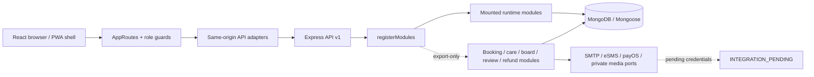
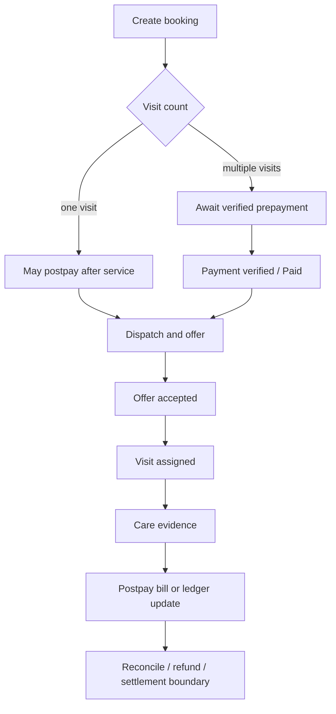
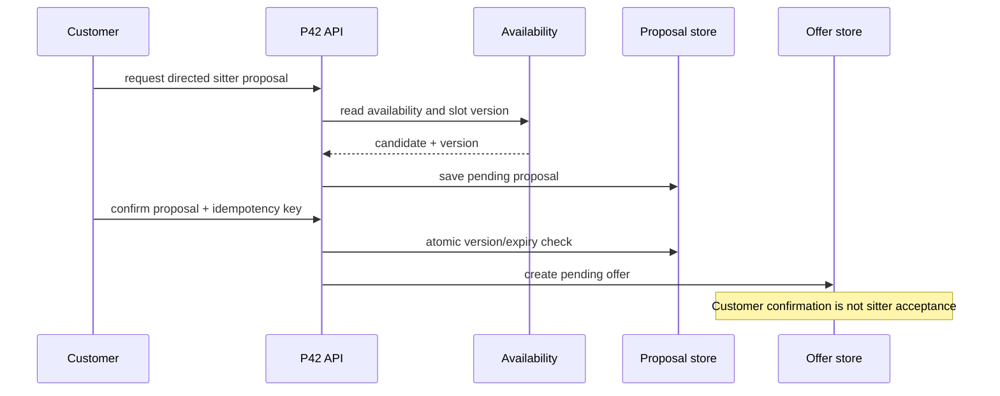
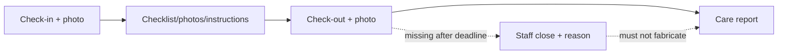

# P37-B — Đồng bộ SDS, API và sơ đồ v1.0

**Ngày kiểm tra:** 15/10/2026 (Asia/Saigon)
**Trạng thái:** audit cục bộ; chưa gọi provider thật và chưa công bố bản diagram nguồn trên Drive.

## SDS hiện trạng

### Runtime modules mounted by `backend/src/app.js`

| Module | Mount | Runtime condition | Evidence |
| --- | --- | --- | --- |
| health | `/` | always | `health.routes.js`, runtime tests |
| public policy | `/api/v1/public` | always | `public-policy.routes.js`, policy tests |
| authentication | `/api/v1` | `AUTH_ENABLED=true` and provider/session ports | `auth.module.js`, auth integration |
| customer profile | `/api/v1/me` | runtime factory returns module | `customer-profile.routes.js` |
| applicant status | `/api/v1/application-status` | runtime factory | `application-status.routes.js` |
| user admin | `/api/v1/users` | `AUTH_ENABLED=true` | `user-admin.routes.js` |

### Export-only modules requiring P34 composition

The following files define a router/module but are not passed to `registerModules` in the current `app.js`: `customer-address.routes.js`, `sitter-application.routes.js`, `service-catalog.routes.js`, `service-price.routes.js`, `system-settings.routes.js`, `visit-board.routes.js`, `booking-change-cancellation.routes.js`, `care-evidence.routes.js`, `incident.routes.js`, `directed-proposal.routes.js`, `refunds.routes.js`, `review.routes.js` and `complaint.routes.js`. Their tests use injected ports or isolated services. A passing fixture test does not make an endpoint reachable in the deployed runtime.

## API boundary synchronization

| Boundary | Canonical contract | Current implementation | Gate |
| --- | --- | --- | --- |
| Auth/session/CSRF | P01 API contract, P06–P09 | Mounted conditionally; `/me` projection is allowlisted | OTP UI, CSRF rehydration and real channels |
| Public policy | P45 policy contract | Mounted public read route and frontend approved-only states | approved content/version source |
| Booking read/change/cancel | P20/P25/P51 | Services and routers exist in working tree | P34 registration, booking repository, money decisions |
| Directed proposal | P42 | service/router with version, expiry and idempotency checks | availability, payment and offer repositories |
| Dispatch/visit board | P21/P22/P24 | eligibility and board exports | assignment persistence and runtime registration |
| Care evidence/report | P26/P27 | check-in/out, checklist, photo and report ports | private storage, runtime registration, Staff-close policy |
| Incident/complaint/review | P29/P30/P47 | service/router/page tests | role projections, runtime registration, moderation decisions |
| Payment/refund | P31/P32/P51 | payOS verification and refund lifecycle boundaries | verified provider, ledger, booking billing wiring |
| PWA | P43 | manifest, service worker and online/install hooks | HTTPS/device/offline validation |

Common wire rules remain those in P01: success envelope, error code/status, allowlisted DTOs, server-side role and object ownership checks, CSRF for unsafe browser commands, idempotency for retried commands, and no automatic mutation retry after an uncertain acknowledgement.

## Diagram corrections

The following connectors are canonical for the synchronized diagrams:

Diagram review found three rules that must remain visible in every affected flow: `Paid` is not `Assigned`; Customer-directed confirmation is not sitter acceptance; and Staff-close after missing checkout is not a normal checkout or completed evidence. The old connector that treated all bookings as postpay must be removed from source diagrams.

## Open SDS decisions

- FIN-01…08: payment ordering, slot hold/expiry, allocation and rounding, refund evidence, settlement eligibility and transfer proof.
- P34 route registration and shared repository ports for the export-only modules.
- Provider accounts and private media/storage capability; no credentials are stored here.
- Figma frame IDs for role dashboards, care evidence and PWA states; current status is `NOT_INSPECTED`.
